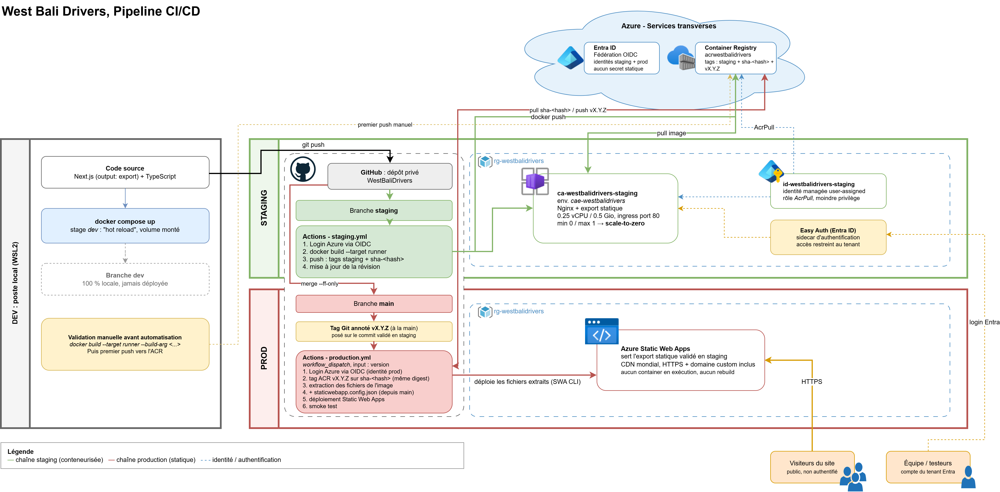

# Mettre en place un pipeline CI/CD sur Azure

<br>

## De quoi ça parle

Ce dépôt documente, sous forme d'articles, la mise en place d'un pipeline CI/CD complet sur Azure pour **West Bali Drivers**, un site vitrine pour un réseau de chauffeurs à Bali. Le site lui-même (Next.js, statique, sans backend) n'est qu'un prétexte : ce qui est documenté ici, c'est l'infrastructure et l'automatisation qui permettent de le livrer de façon reproductible, sécurisée et professionnelle.

Le fil conducteur est volontairement pédagogique et transparent : chaque brique est d'abord validée manuellement (build local, push manuel, création manuelle des ressources Azure) avant d'être automatisée dans un pipeline GitHub Actions. Les choix, les impasses et les erreurs de parcours sont documentés au même titre que les solutions retenues.

Je fonctionne aujourd'hui selon les principes DevOps mais ne suis pas développeur : je viens du monde systèmes et réseaux. Cette série s'adresse donc naturellement à un public familier de l'infra plutôt qu'à des développeurs pur jus, avec des analogies système à chaque nouvelle brique.

<br>

## Architecture cible

Le pipeline s'articule autour de trois environnements, qui reposent volontairement sur trois logiques de déploiement différentes plutôt qu'une seule stack uniforme.

Spoiler, l'ensemble ressemblera à ça :



Mais ne fuyez pas : tout cela fera sens au gré de la lecture. Un schéma en apparence compliqué, pour un principe finalement assez simple.

Pourquoi cette rupture volontaire entre un staging conteneurisé et une prod qui ne l'est pas ? La réponse est détaillée dans l'[article 1](./article_1.md).  
En résumé : faire tourner un container 24h/24 pour servir des fichiers HTML statiques est une dépense que le besoin ne justifie pas, alors qu'Azure Static Web Apps fait exactement ce travail gratuitement. Le pipeline conteneurisé reste néanmoins la fondation sur laquelle la prod basculera dès que l'application gagnera un backend.

<br>

## Le workflow en bref

<br>

| Étape | Qui s'en occupe | Ce qui se passe |
|---|---|---|
| **Développement** | Moi | Développement local avec hot reload dans un container Docker (`docker compose up`). |
| **Push sur `staging`** | Moi | Un simple `git push`. Je n'ai plus rien à faire. |
| **Le build** | GitHub Actions | Build de l'image Docker, push vers ACR sous deux étiquettes : `staging` (mobile) et `sha-<hash>` (immuable, pour retrouver n'importe quel commit). |
| **Le staging** | Container Apps | Une nouvelle révision démarre avec l'image fraîchement poussée. Je vérifie le site comme un vrai visiteur. |
| **Validation** | Moi (la seule décision humaine) | Si tout est bon : tag Git `vX.Y.Z` posé sur le commit validé. |
| **Passage en prod** | GitHub Actions | `workflow_dispatch` : l'image de l'actuel staging reçoit l'étiquette `vX.Y.Z`, les fichiers statiques en sont extraits et partent sur Static Web Apps. |
| **Smoke test** | GitHub Actions | Le workflow vérifie que le site répond, sinon il passe au rouge. |
| **Un souci ?** | Moi | Même commande, avec un ancien numéro de version. Aucun build supplémentaire nécessaire. |

<br>

#### Une mise en production, en trois lignes :

```bash
git tag -a v0.3.0 origin/staging -m "MaJ site: ajout tour"
git push origin v0.3.0
gh workflow run production.yml --ref main -f version=v0.3.0
```

<br>

#### Tableau de bord

| | Staging | Production |
|---|---|---|
| **URL** | https://ca-westbalidrivers-staging.wittyflower-e45a1bcb.westeurope.azurecontainerapps.io | https://mango-cliff-05bf87d03.4.azurestaticapps.net |
| **Hébergement** | Azure Container Apps (container Nginx) | Azure Static Web Apps (fichiers statiques) |
| **Déclencheur** | *git push* sur staging | Lancement manuel du workflow, avec un tag de version |
| **Source de l'artefact** | Build de l'image Docker | Promotion de l'image validée en staging (aucun build) |
| **Temps de déploiement** | ⏱️ _à compléter_ | ⏱️ _à compléter_ |
| **Rollback / roll-forward** | n/a | ⏱️ _à compléter_, sans aucun build |
|**Coût d'hébergement** | ~4€ / mois (Azure Container Registry) | 0 € (Static Web Apps, plan Free) |


<br>

## Les articles

### [Partie 1 : Présentation du projet](./article_1.md)
Le point de départ de la série : pourquoi ce projet, quelle stack technique (Next.js en export statique, TypeScript, Tailwind, Mapbox, Cloudinary, Docker, pnpm), et surtout pourquoi les trois environnements dev / staging / prod reposent sur trois logiques de déploiement radicalement différentes. Un article de contexte, indispensable pour comprendre les arbitrages des chapitres suivants.

### [Partie 2 : Containerisation](./article_2.md)
Écriture du Dockerfile multi-stage (dev, builder, runner), du `docker-compose.yml` pour l'environnement de développement avec hot reload, de la configuration Nginx, et validation complète en local avant de toucher à Azure. Le cœur technique : pourquoi et comment containeriser un site qui n'a, en apparence, pas besoin de l'être.

### [Partie 3 : Azure Container Registry](./article_3.md)
Création d'un registre de containers privé sur Azure, stratégie de tagging (`staging` + SHA de commit pour le rollback), et premier push manuel de l'image pour valider la chaîne de bout en bout avant automatisation.
*Annexe : [initialiser le dépôt Git et le connecter à GitHub](./article_3_annexe.md).*

### [Partie 4 : Azure Container Apps](./article_4.md)
Déploiement de l'image sur un environnement de staging serverless avec scale-to-zero : identité managée et permission `AcrPull` sans mot de passe, création de l'environnement Container Apps, et les quelques surprises de l'outillage PowerShell Azure au passage.
*Annexe : [restreindre l'accès avec Entra ID (Easy Auth)](./article_4_annexe.md).*

### [Partie 5 : GitHub Actions pour le staging](./article_5.md)
Le grand assemblage : fédération d'identité OIDC entre GitHub et Azure (zéro secret statique), puis écriture du workflow qui build, pousse vers ACR et déploie automatiquement sur Container Apps à chaque push sur `staging`.

### [Partie 6 : La production sur Azure Static Web Apps](./article_6.md)
Un changement de cap assumé : plutôt que de reconstruire le site pour la prod, on promeut l'image validée en staging (*build once, deploy many*). Création de la Static Web App, configuration d'hébergement (en-têtes de sécurité, CSP en Report-Only, gestion des 404), tag de version Git et ACR, et première mise en production entièrement manuelle avec la SWA CLI.

### [Partie 7 : Automatiser la mise en production](./article_7.md)
Retirer l'humain des gestes mécaniques, pas de la décision : une identité OIDC dédiée à la prod, un rôle Azure sur mesure pour le moindre privilège, un workflow `workflow_dispatch` qui promeut un tag en un clic, un rollback sans rebuild, et enfin la politique de rétention d'ACR laissée en suspens depuis l'article 3.

<br>

## À venir

- **Partie 8** : brancher le domaine custom et ouvrir le site aux moteurs de recherche